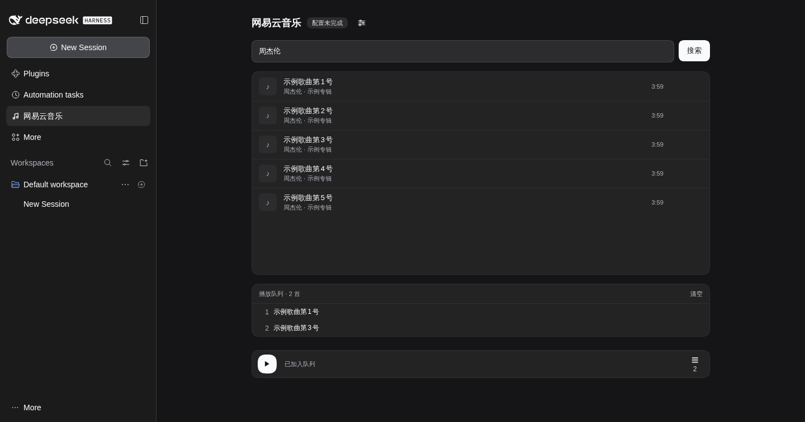
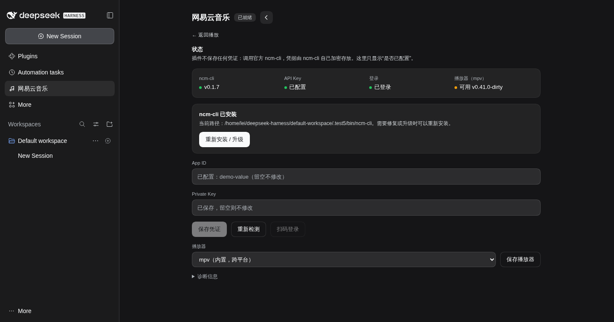
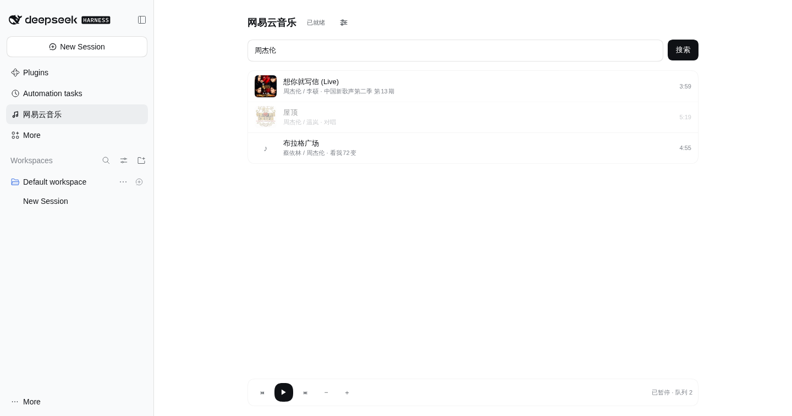

# dsh-plugin-netease-music

网易云音乐 for DSH Web UI。底层只调用官方的 [`ncm-cli`](https://www.npmjs.com/package/@music163/ncm-cli)，插件本身不碰任何凭证、签名或音频地址。

装好之后：侧边栏点「网易云音乐」→ 点标题旁的设置按钮一键安装 CLI、填 `appId` / `privateKey` → 扫码登录 → 搜歌、点歌、播控，全程不用开终端。





## 依赖

| 依赖 | 说明 |
| --- | --- |
| DSH `>= 0.2.0` | Web profile |
| Node.js `>= 18` | `ncm-cli` 的要求 |
| `ncm-cli` | 设置页里一键安装，或手动 `npm install -g @music163/ncm-cli` |
| `mpv` | 出声必需；`brew install mpv` / `sudo apt install mpv` |
| 开放平台 API Key | [developer.music.163.com](https://developer.music.163.com/st/developer/apply/account?type=INDIVIDUAL) 自助入驻获取 `appId` + `privateKey` |

## 安装

```bash
# 直接从 GitHub 安装
dsh plugin --profile web add github:leido/dsh-plugin-netease-music

# 或从本地目录
dsh plugin --profile web add /absolute/path/to/dsh-plugin-netease-music
```

安装会同时把包写进 profile 的 `dsh.profile.bundles`，重启 `dsh web` 后生效。

装完刷新页面。若 GUI 里的 PATH 找不到 `ncm-cli`（nvm / pnpm / macOS GUI 启动常见），在 profile 的 `cordis.patch.yml` 里给绝对路径：

```yaml
- id: netease-music
  name: dsh-plugin-netease-music
  config:
    cliPath: /Users/you/.nvm/versions/node/v22.0.0/bin/ncm-cli
```

## 配置

打开侧边栏「网易云音乐」，点标题旁的设置按钮（滑块图标）：

1. 若状态卡片显示“ncm-cli 未安装”，点「安装 ncm-cli」——插件会执行 `npm install -g @music163/ncm-cli`，把实时日志显示在下方，完成后自动采用安装路径（即使该目录不在 DSH 进程的 PATH 里）。
2. 填入开放平台的 `App ID` 与 `Private Key`，点「保存凭证」。
3. 点「扫码登录」，把返回的链接用网易云 App 打开完成授权；成功后状态变绿。
4. 状态卡片会同时检测 `ncm-cli` 版本、凭证、登录态与 `mpv`，哪一步缺了会直接说清楚。

> 凭证由 `ncm-cli` 自己加密存放在 `~/.config/ncm-cli/credentials.enc.json`。
> 插件既不读取也不回传明文 `privateKey`，界面上只显示「已配置」。

## 使用

- 左侧边栏「网易云音乐」（在“自动化任务”下面）打开播放页，输入关键词回车搜索。
- 标题旁的滑块按钮切到设置面板，再点一次（或「← 返回播放」）回到播放。
- 搜索结果上悬停有三个操作：▶ 播放、↵ 下一首播放、＋ 加入队列。
- 播放条右侧 ☰ 打开播放队列抽屉：显示当前曲目与队列顺序，可一键清空；随播放自动刷新。
- 点击结果即播放；不可播放（`visible: false`）的曲目会置灰。
- 底部是上一首 / 暂停 / 下一首 / 音量。
- 播放状态始终来自 `ncm-cli state`，插件不维护第二份状态。

## Agent 工具

装好插件后，模型也能直接点歌（与 UI 共用同一个适配层）：

| 工具 | 参数 | 用途 |
| --- | --- | --- |
| `netease_search` | `keyword` | 搜歌，返回歌名 / 歌手 / 时长 / 可播性 / 链接 |
| `netease_play` | `query` | 按关键词搜索并播放第一首可播结果 |
| `netease_control` | `action`（枚举） | pause / resume / stop / next / prev |
| `netease_set_volume` | `level` | 音量 0–100 |
| `netease_seek` | `seconds` | 跳转进度 |
| `netease_status` | 无 | 就绪状态 |

> 工具参数的 schema 会被模型服务严格校验：属性名不能撞 JSON Schema 关键字（`type`、`enum`…），且全部必填。踩过这个坑——一个属性不合法会让**整段对话**报错，而不只是这个工具。设置项 `toolsEnabled: false` 可整体关闭工具面，UI 不受影响。

## 设计

```
浏览器                            Host
┌──────────────────────┐   fetch   ┌─────────────────────────────┐
│ lib/client.js        │ ────────► │ /netease-music/api/*        │
│  settings.section    │           │   status / config / login   │
│  shell.overlay       │           │   search / play / control   │
└──────────────────────┘           │        │                    │
                                   │        ▼                    │
                                   │   lib/ncm-cli.js ──► ncm-cli │
                                   │        │                    │
                                   │        ▼                    │
                                   │   ctx.tools（Agent 工具）     │
                                   └─────────────────────────────┘
```

几个刻意的取舍：

- **不封装 API。** HTTP 请求、签名、token 续期、频控全部由官方 CLI 负责；插件只做「把领域动作翻译成一条命令」和「把命令结果翻译成 UI 结构」。
- **不硬编码命令树。** `search` 这类命令是 CLI 运行时动态注册的，所以插件在缺失时给出可执行的解释（"需要有效的 API Key 和网络"），而不是报一个 `unknown command`。
- **安全边界。** 写操作要求同源 `Origin` 且带 `x-ncm-request` 头（跨站请求会被浏览器预检拦下）；响应里永远没有 `privateKey`；CLI 调用日志对 `config set privateKey` 做脱敏。
- **客户端零依赖。** `lib/client.js` 是预打包的 DSH client module，只 `require` 壳提供的 `react` / `react/jsx-runtime`，不引入第二份 React。
- **样式跟随主题。** 全部颜色/圆角/字体取自 DSH 的设计令牌（`--dsw-*`），不写死调色板，也不依赖 `prefers-color-scheme`——所以应用切深色/浅色时插件跟着变。

## 排错

| 现象 | 原因 / 处理 |
| --- | --- |
| 状态显示「ncm-cli 未安装」 | 没装，或 GUI 的 PATH 找不到；用 `config.cliPath` 指定绝对路径 |
| 「API Key 未配置」 | 没填，或填完没点保存 |
| 搜索报「没有注册 search 命令」 | Key / 网络不通时 CLI 不会注册动态命令；先确认状态卡片三项全绿 |
| 点了播放没有声音 | `mpv` 未安装，或播放器设成了仅 macOS 的 `orpheus` |
| 「请求总量超限」 | 官方频控；插件原样透传，不重试 |
| 点了歌曲没反应 | 0.2.2 之前的版本没有解析出加密 ID（CLI 的字段名是 `id`），已修复；失败时现在会在播放条上方显示红色错误条 |
| 「ncm-cli 没有返回任何内容」但歌在放 | `play` 是把歌曲发给播放服务即返回，个别路径不打印任何输出；0.2.5 起播放/播控命令的"空输出 + 退出码 0"按成功处理，JSON 也会从 stderr 兜底解析 |
| 播放条不显示正在播什么 | 状态行现在显示 `播放中 <标题> · m:ss`（来自播放服务的 `title` 和 `position`），并每 2 秒轮询保持同步 |

## 已知限制

- **声音从 Host 机器出来。** 官方 CLI 通过 `mpv` 在运行 DSH 的那台机器上播放；浏览器内 `<audio>` 播放需要音频直链，官方接口不提供（属商务授权范畴）。
- 首版不做歌单编辑与歌词滚动。

## 开发

```bash
npm install          # 仅 esbuild
npm run build        # src/client.tsx -> lib/client.js
npm run check        # 工具 schema 红线检查
```

`npm run check` 守两个坑：

1. **schema**：模型服务对工具 `input_schema` 校验极严，属性名撞关键字（`type`/`enum`…）
   或参数选填都会让**整段对话** 400。
2. **返回值**：执行器会拿工具结果对它自己声明的 `output.schema` 做校验，且要求无损 JSON。
   CLI 用 `null` 表示“没有值”，而字段声明是 `string`；`undefined` 更不是合法 JSON。
   `JSON.stringify` 会把这两种字段静默吞掉，所以肉眼和普通单测都发现不了——
   脚本会真的执行每个工具，再用 schema 逐字段校验。

改完工具先跑它，两个问题都能在本地拦住。

`lib/client.js` 是产物，随包提交；Host 侧代码是手写 ESM，无构建步骤。
